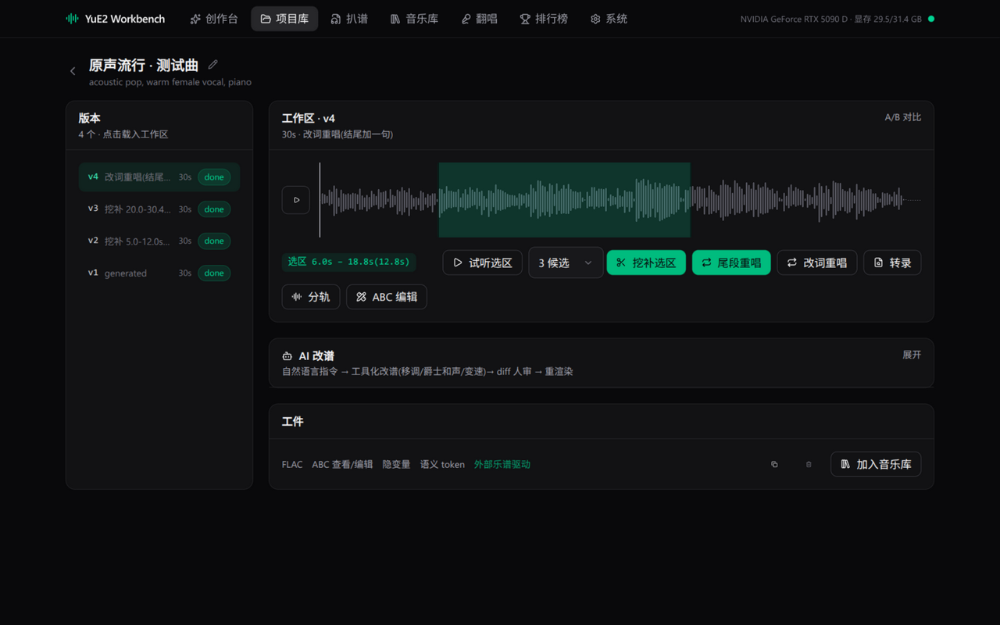
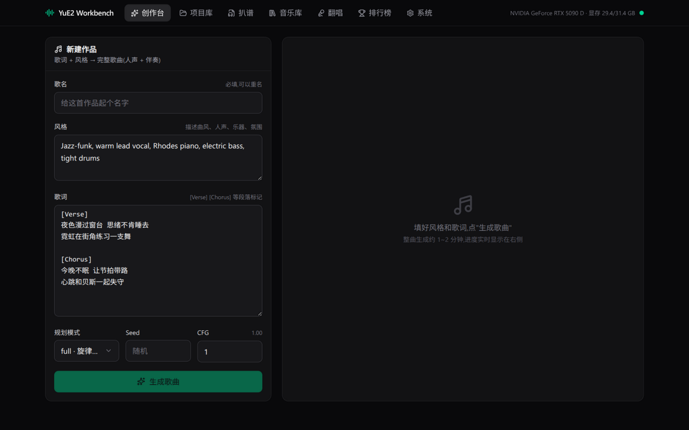
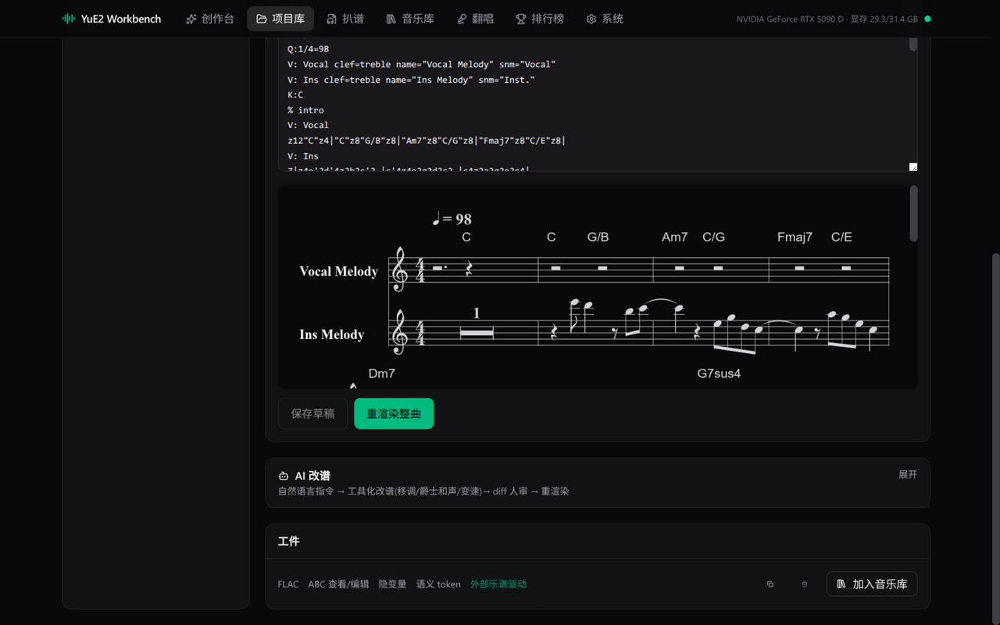
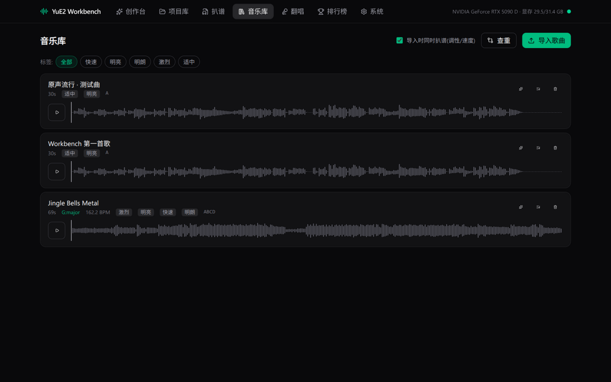
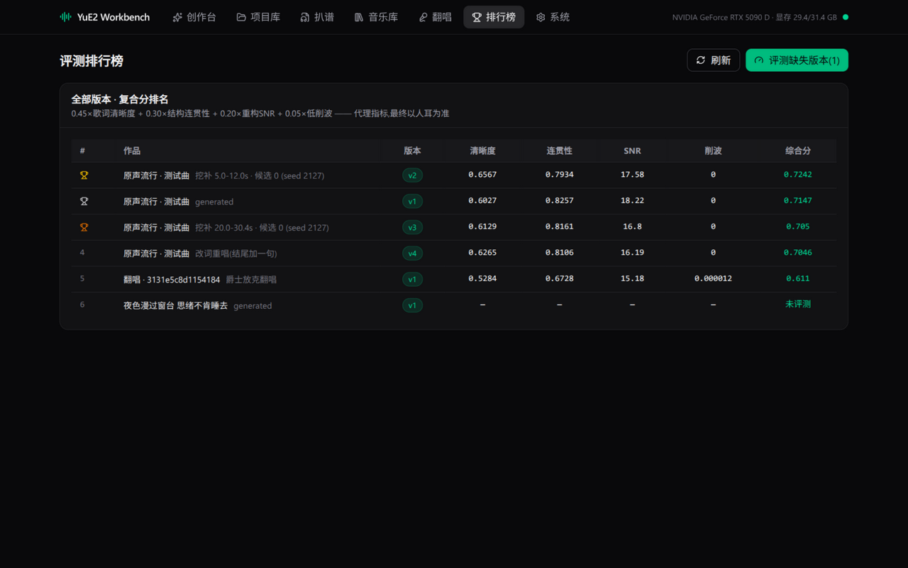
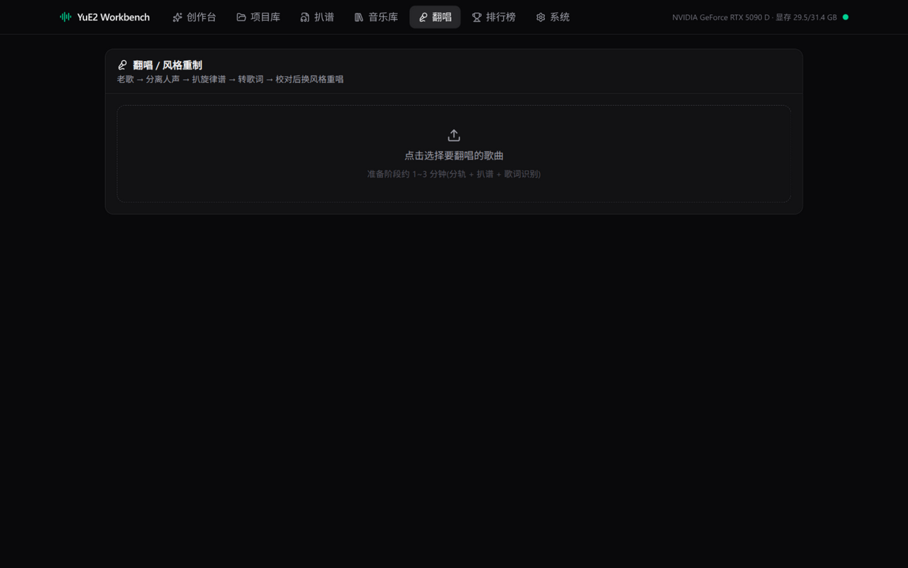
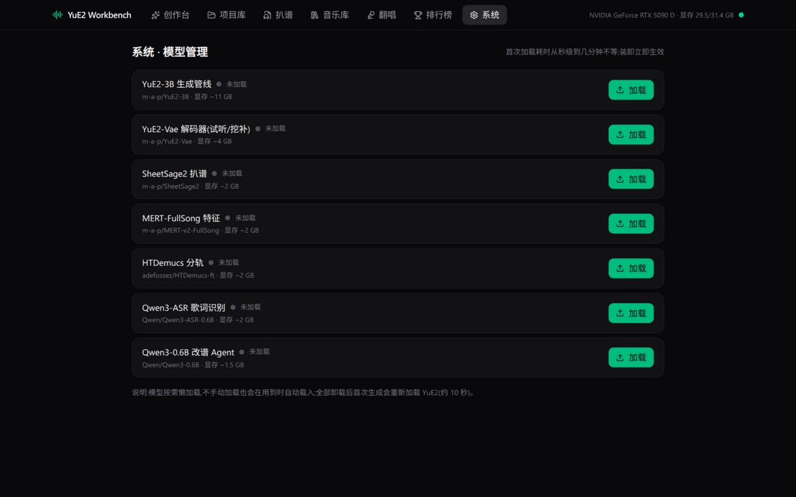

# 🎹 YuE2-Workbench

**整合式 AI 音乐工作台** — 歌词一键成歌、老歌翻唱重制、乐谱驱动的 DAW 式编辑、自动扒谱、音乐库理解与自动评测,全部跑在本地单卡上,离线可用。



<p align="center"><i>DAW 工作区:波形拖选 → 区域试听(&lt;1s)→ 挖补候选 → 隐变量域拼回;挖补点之前逐比特不变</i></p>

## ✨ 界面一览

| | |
|---|---|
| **创作台** — 歌名 + 歌词 + 风格 → 整首歌 | **ABC 乐谱编辑** — 文本改谱 + 五线谱实时预览 |
|  |  |
| **音乐库** — MERT 打标 / 相似检索 / 歌单 / 查重 | **评测排行榜** — 自动指标复合分 + A/B 对听 |
|  |  |
| **翻唱流水线** — 分轨 → 扒谱 → 歌词 → 重唱 | **系统** — 七模型驻留管理与手动装卸 |
|  |  |

## 🧩 功能模块

- **AI 唱作**:歌词 + 风格 → 48kHz 立体声完整歌曲(人声 + 伴奏),最长约 5 分钟;三种规划模式(full / melody / off)
- **乐谱驱动编辑**:每次生成落盘 ABC 乐谱 + 语义 token + 隐变量;整曲重渲染 / 尾段重唱 / 区域挖补(同谱不同演绎,2~8 候选,强拍线自动对齐)/ 改词重唱
- **AI 改谱 Agent**:自然语言 → 工具化改谱(移调 / 爵士和声 / 变速)→ diff 人审 → 重渲染
- **自动扒谱**:任意音频 → 主旋律 + 和弦 + 节拍 + 调性,应用内五线谱渲染,分轨 MIDI 导出
- **音乐库理解**:MERT 打标(能量 / 亮度 / 速度 / 调式)、相似检索、歌单生成、翻唱查重
- **自动评测**:歌词清晰度 / 结构连贯性 / VAE 重构 SNR / 削波率,复合分排行榜 + A/B 对听
- **分轨**:HTDemucs 四轨分离,工作区独立试听

## 🤖 模型(全部本地 HF 缓存离线运行)

[m-a-p/YuE2-3B](https://huggingface.co/m-a-p/YuE2-3B)(生成) · [m-a-p/YuE2-Vae](https://huggingface.co/m-a-p/YuE2-Vae)(编解码) · [m-a-p/SheetSage2](https://huggingface.co/m-a-p/SheetSage2)(扒谱) · [m-a-p/MERT-v2-FullSong](https://huggingface.co/m-a-p/MERT-v2-FullSong)(理解) · [adefossez/HTDemucs-ft](https://huggingface.co/adefossez/HTDemucs-ft)(分轨) · [Qwen/Qwen3-ASR-0.6B](https://huggingface.co/Qwen/Qwen3-ASR-0.6B)(歌词) · [Qwen/Qwen3-0.6B](https://huggingface.co/Qwen/Qwen3-0.6B)(改谱 Agent)

## 🏗️ 技术栈

FastAPI(SQLite + 任务队列 + SSE 进度) · Vite + React + TypeScript + Tailwind CSS v4 · wavesurfer.js + abcjs · 单卡懒加载 ModelManager

## 🚀 快速开始

```bash
# 1) 环境(.venv:torch 2.11.0+cu130 / transformers 4.57.6 / yue2-infer 0.1.6)
#    缺依赖时:
uv pip install --python .venv/bin/python fastapi "uvicorn[standard]" sqlalchemy pydantic-settings \
  transformers==4.57.6 huggingface-hub==0.36.2 tiktoken soundfile accelerate \
  pretty_midi mido mir_eval scipy qwen-asr
uv pip install --python .venv/bin/python --no-deps ../YuE2-Studio/yue2_infer-0.1.6-py3-none-any.whl
uv pip install --python .venv/bin/python --no-deps demucs julius lameenc openunmix dora-search

# 2) 前端构建(或 ./server.sh build)
cd web && npm install && npm run build && cd ..

# 3) 启动(前端 dist 由后端同服,打开 http://127.0.0.1:8000)
./server.sh
# 开发热更新模式:./server.sh dev (后端 8000 + Vite 5173)

# 4) 冒烟
.venv/bin/python smoke/smoke_all.py
```

冒烟实测(2026-10-27,RTX 5090 D):YuE2 加载 9.4s,39s 歌曲端到端 13.3s;SheetSage2 加载 22.2s、转录 5.0s(ABC / 分轨 MIDI / 节拍·和弦·调性·结构标注);MERT 提特征 2.8s;HTDemucs 四轨 4.3s;VAE 解码 1.0s。

> 注意:SheetSage2 固定父模型 MERT-v2-FullSong 的特定 revision(自动联网校验,勿开 `HF_HUB_OFFLINE=1` 跑它)。

## 📂 文档

- 总体规划与分期路线:[docs/PLAN.md](docs/PLAN.md)
- API 设计与已实现对账:[docs/API.md](docs/API.md)

## ⚠️ 许可

代码 MIT。所涉模型权重均为 **CC BY-NC 4.0,仅限非商用**。
